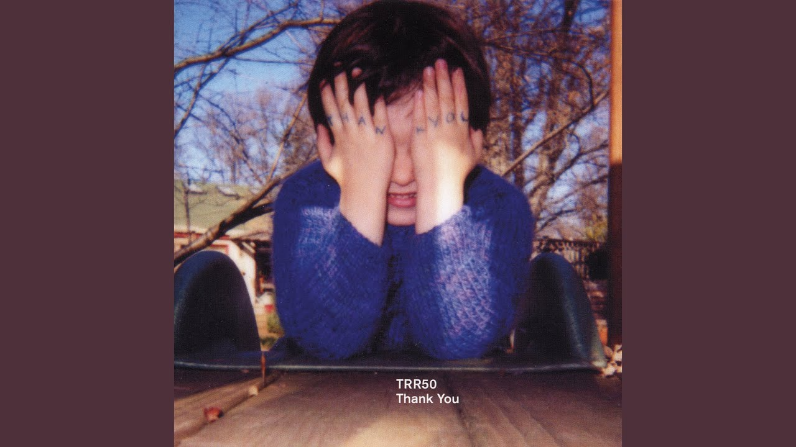
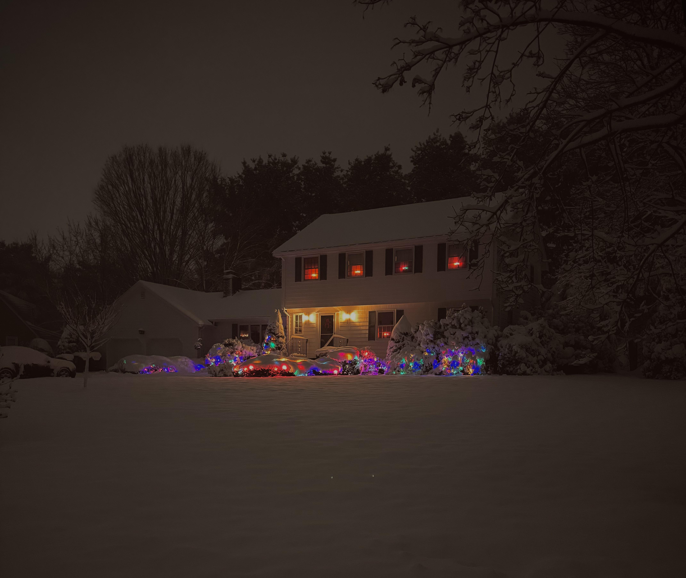
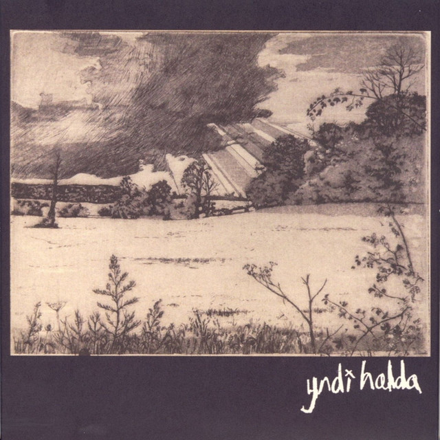

# Welcome 

Welcome to ***Ranlogs***

***Always scroll down for new logs***

# Randomness

I really believe in randomness that's what this whole site is all about. 
But one might ask, why?

Well, I have two answers for that:
1. I really want to make blogging or brainstorming fun, and this removes all possible friction.
2. I really like doing it this way.

# What’s this website running on?

Just a single HTML file, a single .md file, and a ~300-line Python script that converts my Markdown into HTML
Font is Departure Mono: https://departuremono.com/

# Grass is always greener on the other side

Always.

# Felicity

A fleeting felicity, shadowed by sorrows yet to come; for what are joy and grief but passing visitors, 
when the heart is set upon a purpose beyond them both?

9/10/26

# Bryan Johnson -->  [Read More](https://en.wikipedia.org/wiki/Bryan_Johnson)

Stuck in a loop of nothing.
but making it look like he is doing something very great for humans he is not.

11/10/26

# Too much Jargon

Fast-paced life is literally a wasted life; the faster you move, the stupider you become.

20/10/26

# AI

> The bread is full of microplastics, and the circus is A.I. generated.

You still enjoying that microplastic bread?

1/11/26

# Machine

> Slow, Fast, Big, Small, Industrial, Commercial.

It's *exhausting,* continuous, repetition, Short term pleasure.
yes
Yes
You invented something.
Now you are free. 

3/11/26

# No Time

So many things pending ( imp ones )

5/11/26

# The Four Trees

Best Post-Rock Playlist ever
Yeah you can argue with - *"Lift Your Skinny Fists like Antennas to Heaven"*.

6/11/26

# Based [Things I use]

1. Old Laptop running arch [xfce]
    - Xfce Terminal 
    - Brave
    - Screen shot tool
    - Mousepad
    - vim, nvim

2. Mostly everything is on paper not a big fan of digitalism 
    for to do list a short notebook 
    for journaling [legal paper]
    Any pen

# Wisdom

Really far away from me 
Really close to me
but I can't touch it right now.

# Beyond Compare Solo

10/11/26

# Christmas 

[source](https://www.reddit.com/r/TheNightFeeling/s/xKTJecdnmx)

# Internet

I just realised how humans are really indenpendt on internet 
It is really really mind bending.
[yea my wifi was not working for like 3hrs (and I listed out 100 Imp things to-do.]

12/11/26

# Hyperthymesia

It's 50-50 in me

13/11/26

# Yndi Halda

 

Looping 
* Enjoy Enternal Bliss - [Album](https://open.spotify.com/album/3V2hqMSF0oUvqSbSOkcx4G?si=awIqPhshQAK4u9P7MYh3vQ)

# Vim

Discovered a new shortcut `shift + 8` lets you search for the word your cursor is on. Absolute easter egg (atleast for me)

14/11/26
